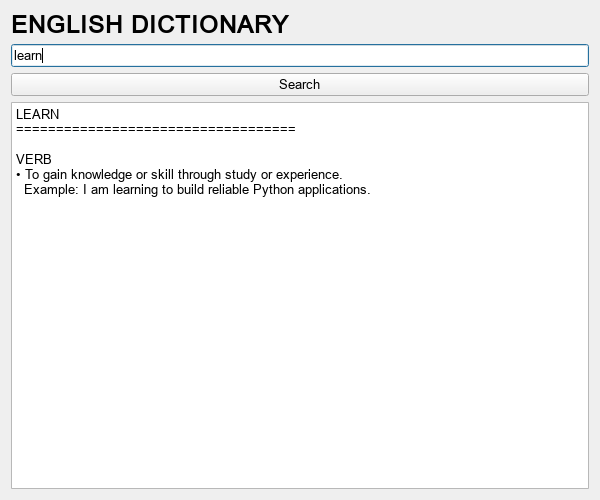

# My Dictionary

[](https://github.com/OmarShemis/dictionary-app/actions/workflows/tests.yml)

A small English dictionary desktop app built with Python and PySide6.
Definitions and examples come from https://dictionaryapi.dev/ and require an internet connection.
Search with the button or Enter. Lookups run in the background so the window stays responsive.

## Setup and run

Requires Python 3.13 or newer.

With uv:

```powershell
uv sync
uv run dictionary-app
```

Or with pip:

```powershell
python -m venv .venv
.venv\Scripts\python -m pip install -r requirements.txt
.venv\Scripts\dictionary-app
```

You can also run `python -m dictionary_app` after installation.
The original `python src/main.py` launcher remains available.

## Development

- `src/dictionary_app/dictionary.py`: API requests, error messages, and result formatting.
- `src/dictionary_app/ui.py`: Qt window and background worker.
- `tests/test_dictionary.py`: offline lookup tests using mocked HTTP responses.

Run tests:

```powershell
uv run python -m unittest discover -s tests -v
```

Project dependencies are declared in `pyproject.toml`; `requirements.txt` installs that project.
After changing dependencies, run `uv lock` to refresh `uv.lock`.

## Architecture and verification

[Architecture](docs/architecture.md) · [MIT licence](LICENSE). Unit tests and CI are reproducible with the commands above. Live API/model quality requires separate evaluation.

## Preview



Actual application rendered with illustrative sample data. The dictionary definition is an offline fixture; the invoice uses a fictional customer.
